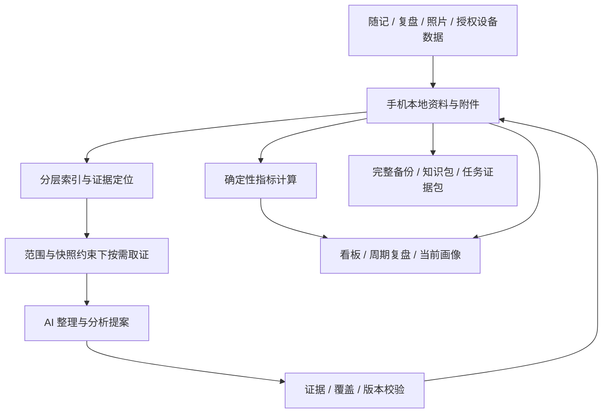

# Trace Life

面向个人的 Android AI 记录与知识管理应用。将日常随记和复盘组织成可追溯、可分析、可迁移的个人知识库，帮助理解近期变化、长期模式和下一步行动；计划扩展授权健康数据，餐食照片分析暂缓。

**当前阶段：M4 跨任务画像维护后端。** 已有 M1 离线记录入口、M2 数据转移、受控分析、DeepSeek 整理与核对、知识发布、记录指标、周期综合、分层归并、原文核对、行动回看和看板接口；已有八维画像的分类、采用、历史、证据定位与迁移；已有按指定维度分批生成、核对及明确保存画像候选；新增历史判断与反馈比较、原文反例扫描和明确更新，尚未接入页面。真实模型验证范围见[实际验证](docs/DEEPSEEK.md#实际验证)；长期倾向自动推断、后台调度、健康指标和华为接入仍待实现。本仓库管理项目设计和代码，个人资料保存在应用数据区。

## 当前可用功能

- 新建、编辑随记和复盘；记录日期、日期区间或未知时间，支持补记及多个主题。
- 按日期与主题分页查阅，查看修订历史、归档／恢复和永久删除。
- 使用内置每日、每周、事件模板；导入文本或 Markdown，预览后保存个人模板，并保留版本与旧复盘绑定。
- 将图片作为受管附件保存；当前阶段尚不识别食物或生成 AI 分析。
- 使用系统标准控件提供操作入口，暂不进行视觉设计。

新增后端能力：可移植口令加密备份、带预览与版本检查的恢复、分层 Markdown／JSONL 阅读包，以及指定问题／范围的证据包。用法、格式与限制见[数据转移接口](docs/DATA_TRANSFER.md)。完整备份保留修订、旧模板绑定、附件与删除记录；阅读包明确不用于恢复。

受控分析后端支持按范围分页定位、按字段分片取证、完整请求预算、每次调用的引用校验、失败恢复和幂等重试。结果保存为待核对提案，来源变化会阻止旧任务继续执行；任务与证据台账同时纳入加密备份。用法见[受控分析接口](docs/CONTROLLED_ANALYSIS.md)；DeepSeek 密钥配置、自动分批及显式真实测试见[接入说明](docs/DEEPSEEK.md)。

陈述核对重新取得原文及显式选定的上下文，分别保存模型意见、用户确认／纠正／否定及证据有效性。用户独立文字在来源删除后仍保留，旧备份不能覆盖目标库已有反馈；用法与限制见[核对与反馈接口](docs/CLAIM_REVIEW.md)。

通过最新核对的陈述可条件发布为观察、知识条目或经用户确认的洞察，保留修订、证据与失效状态，并进入分层阅读包。记录指标由程序计算每日记录数和日期覆盖，支持按原始记录下钻；不据此计算成长或健康评分。用法见[知识与指标接口](docs/KNOWLEDGE.md)。

自动整理可在共享请求上限内继续提取、核对与发布，保留失败和待确认状态。周期材料按原模板意图组织期望、实际、因素、经验、行动与回看，支持原文分片查阅及 Markdown／JSON／CSV 包导出；这是已有材料视图，尚未生成新的周期判断。接口和限制见[自动整理与周期复盘材料](docs/PERIOD_REFLECTION.md)。

新增综合接口对多条原文作有界对照，提出待确认解释，并在核对时重读全部批内上下文；大范围分批完成与跨批统一综合分别报告。用户可明确选择行动实验，保存触发、做法、预期信号、回看日期，之后记录执行、观察、调整或停止；修订及回看纳入完整备份。用法见[综合与行动接口](docs/SYNTHESIS_ACTIONS.md)。

新增分层归并将多个综合批次按预算逐层整理为周期草稿，保留依赖、空结果和覆盖缺口，支持原文下钻与反馈失效传播。通过[分层周期草稿](docs/PERIOD_REDUCTION.md)生成后，可逐批扫描完整来源链、重新核对全部相关原文，并在用户确认后发布为正式洞察。扫描、最终意见和采纳决定分别保存；预算不足或上下文缺口会阻止发布，父反馈变化与删除向知识、行动来源和导出传播。用法见[周期原文核对与发布](docs/PERIOD_REVIEW.md)。

新增[受控指标分析](docs/METRIC_ANALYSIS.md)，由程序计算完整范围的记录覆盖，AI 解释后重新计算并核对；用户确认后可发布洞察，凭据随备份和范围导出保存。模型只读取统计结果及口径，原始来源清单保存在本地。

新增[看板数据接口](docs/DASHBOARD.md)，提供 7／30／90 天记录覆盖、前期比较、实际贡献来源下钻、匹配的已发布说明及全局行动回看，支持 Markdown／JSON／CSV 包导出。健康卡片如实显示来源不可用；资料、反馈、行动变化或跨日到期时拒绝旧快照。本轮不新增模型请求，页面和关注项偏好保存后置。

新增[画像采用与维护接口](docs/PERSONAL_PROFILE.md)，将已有观察／洞察按八个维度及长期、情境、近期层次组织，保存候选、采用、不采用、被替代与独立用户文字。固定知识修订和证据仍由知识库维护，来源失效后退出当前画像；支持历史分页、证据下钻、完整备份和分层阅读导出。该维护接口组织已有知识；新的描述通过[受控画像候选生成](docs/PROFILE_CANDIDATES.md)从限定范围原文分批提出，重读整批原文核对，由用户确认后明确保存为候选，采用仍是独立操作。生成只支持近期状态与情境模式，多批尚未整合及反例搜索缺口分别报告。

新增[跨任务画像维护](docs/PROFILE_MAINTENANCE.md)，对新候选逐项检查已有画像及历史纠正、否定、撤回，再分批扫描当前范围全部可读原文。最终核对重读相关原文和生成批次，保留反例与缺口；用户明确选择后在原画像 ID 上收窄或替换，保留历史、独立文字并回到候选。比较关系不等于新的原始证据，模型建议不会自动采用。

构建、安装及验证命令见[开发文档](docs/DEVELOPMENT.md)。当前仍用合成资料验证，文件选择和恢复确认等前端入口后续统一接入。

```bash
./gradlew testDebugUnitTest lintDebug assembleDebug
```

## 产品范围

- **低负担记录**：随手写、不完整记录、事后补记；可选有深度的日／周／事件复盘，支持导入个人模板。
- **AI 整理与分析**：提取观察、知识和有依据的洞察，形成行动并在后续复盘中回看。
- **关键趋势看板**：聚焦睡眠、运动、饮食、工作学习及行动的关键变化，数值可追溯，缺失资料明确显示。
- **长期个人画像**：区分自述、近期状态、情境模式与长期倾向，保留支持、反例和用户修正。
- **丰富输入**：计划接入华为运动健康，资格、目标字段和真实设备授权仍需验证；餐食拍照分析按用户要求暂缓。
- **资料自主保存**：手机本地主存，支持完整恢复备份、分层知识包、指定范围证据包及指标／报告导出。

首版面向个人使用，不包括多用户服务、通用历史资料导入或多设备双向同步。个人模板导入和完整备份恢复属于首版范围。

## 核心架构

结构化资料与受管附件共同构成权威资料；Markdown、分层索引和看板是可重建视图，已经生成的 AI 分析保留内容、证据和版本。模型读取必须经过程序执行的范围、快照、索引路由与预算约束。



资料保存在本地；用户已选择 DeepSeek 云端模型，调用时会发送本次任务选中的原文片段、已登记的派生草稿或程序指标；画像维护还会按预算读取历史描述和相关用户反馈作为控制背景。凭据独立加密保存，不进入备份或 APK；供应商资料处理依据与限制见[接入调研](docs/research/2026-10-17-deepseek-integration.md)。

## 文档入口

| 目的 | 入口 |
| --- | --- |
| 了解完整产品设计、存储导出及验收场景 | [主设计](docs/superpowers/specs/2026-10-16-personal-knowledge-and-reflection-design.md) |
| 查阅各主题设计和官方研究依据 | [文档导航](docs/README.md) |
| 理解统一术语 | [CONTEXT.md](CONTEXT.md) |
| 决定下一阶段做什么、如何验收 | [开发路线](docs/ROADMAP.md) |
| 构建 APK、运行测试和定位代码 | [开发与验证](docs/DEVELOPMENT.md) |
| 调用备份恢复、知识包与证据包接口 | [数据转移接口](docs/DATA_TRANSFER.md) |
| 调用受控检索、预算执行与分析任务接口 | [受控分析接口](docs/CONTROLLED_ANALYSIS.md) |
| 核对陈述、保存纠正并维护反馈 | [核对与反馈接口](docs/CLAIM_REVIEW.md) |
| 发布知识、分页查阅与计算记录覆盖 | [知识与指标接口](docs/KNOWLEDGE.md) |
| 继续自动整理、查阅周期材料和导出报告 | [自动整理与周期复盘材料](docs/PERIOD_REFLECTION.md) |
| 生成有界综合提案、选择行动与持续回看 | [综合与行动接口](docs/SYNTHESIS_ACTIONS.md) |
| 跨批归并、查看周期草稿与回查原文 | [分层周期草稿接口](docs/PERIOD_REDUCTION.md) |
| 扫描来源、核对周期陈述并正式发布 | [周期原文核对与发布](docs/PERIOD_REVIEW.md) |
| 解释程序指标、重新核对并发布指标洞察 | [受控指标分析](docs/METRIC_ANALYSIS.md) |
| 查阅看板趋势、贡献来源、行动时间线并导出 | [看板数据接口](docs/DASHBOARD.md) |
| 分类和采用画像、查看历史及证据 | [画像采用与维护接口](docs/PERSONAL_PROFILE.md) |
| 分批生成画像提案、核对与保存候选 | [受控画像候选生成](docs/PROFILE_CANDIDATES.md) |
| 比较历史判断、检查反例并更新画像 | [跨任务画像维护](docs/PROFILE_MAINTENANCE.md) |
| 配置 DeepSeek、分批整理与测试真实调用 | [DeepSeek 接入](docs/DEEPSEEK.md) |
| 了解架构取舍 | [本地主存决策](docs/adr/0001-local-source-of-truth.md)、[受控取证决策](docs/adr/0002-controlled-evidence-retrieval.md) |
| 由 AI Agent 继续工作 | [AGENTS.md](AGENTS.md) |
| 提交问题、修改文档或代码 | [CONTRIBUTING.md](CONTRIBUTING.md) |

当前采用 Kotlin、Android 系统控件和 SQLiteOpenHelper，最低支持 Android 8.0（API 26），编译与目标 API 36。备份采用口令派生密钥与 AES-GCM；669 项离线测试、lint 和调试 APK 构建通过，8 项真实 API 测试在普通验证中跳过，分次验证记录见[M4 第四阶段计划](docs/plans/2026-10-19-profile-maintenance.md#验证记录)。DeepSeek 开发机提取、核对、有界综合、分层归并、周期原文核对发布、指标解释、画像候选及跨任务维护通过小样本验证，更广泛的分析质量与实体手机能力仍需分别验证。
