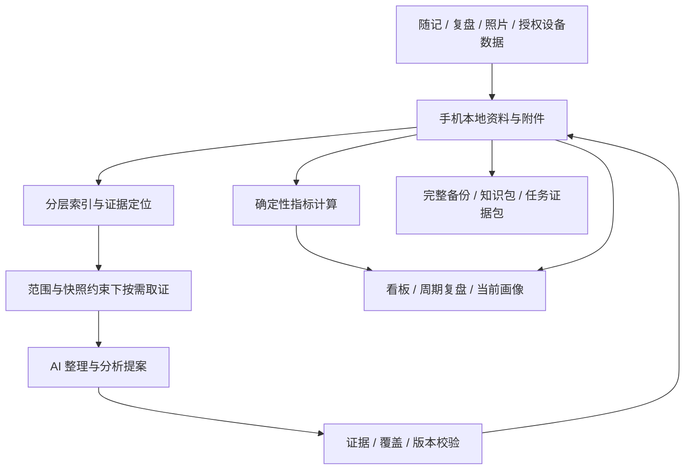

# Trace Life

面向个人的 Android AI 记录与知识管理应用。将日常随记和复盘组织成可追溯、可分析、可迁移的个人知识库，帮助理解近期变化、长期模式和下一步行动；计划扩展授权健康数据，餐食照片分析暂缓。

**当前阶段：完善日常知识库与分析可靠性。** 已有离线随记、专业复盘模板与导入、DeepSeek 受控分析／核对、知识及经验演化、行动回看、长期画像、自由提问及追问。新增周期自动复盘与待查看入口、明确填写的工作学习投入和实践趋势、个人概览、主题叫法及语义导航、含独立说明与历史的阅读包。记录、分析状态、保存与待更新分别显示。华为运动健康连接尚未实现，需实际接入资格、项目配置及设备授权；餐食照片暂缓。实现与验证见[开发文档](docs/DEVELOPMENT.md)与[开发路线](docs/ROADMAP.md)，程序测试、真实模型、模拟器和真机分别记录。

手机试用：[下载 Android 预览版 APK](https://github.com/yyytttwww888-beep/trace-your-life/releases/download/v0.1.0-preview.10/trace-life-0.1.0-preview.10.apk)（Android 8.0 及以上）。安装与验证范围见[开发文档](docs/DEVELOPMENT.md#语义核对修正验证)，电脑预览见[模拟器说明](docs/ANDROID_PREVIEW.md)。

本版功能、验证与仍未实现项见[需求验收矩阵](docs/COMPLETION_ACCEPTANCE.md)。最新修正让核对逐项引用真实字段原文，支持记录日期与已提供的连续分片，并将影响结论的限制一起纳入核对。原始资料仍按范围、快照与预算读取，没有扩大为全库输入。

**模型语义验收仍未完全通过。** 第五轮固定验证中，长复合句仍有时长、比较条件和顺序误判；真实引文及核对支持都不等于内容正确。已修程序边界、全部失败与最新结果见[语义核对复评](docs/reviews/2026-10-20-semantic-evidence-repair-review.md)，此前版本的[独立质量评审](docs/reviews/2026-10-20-complete-daily-knowledge-quality-review.md)继续保留。

**用户旅程优化（2026-10-20）：** 根据[评审报告](docs/reviews/2026-10-20-user-knowledge-journey-review.md)修复保存与有效性混淆，新增范围维护、按依赖删除、主题阅读、经验到行动和手机文件交付。经验演化、历史意见与任务归档已按[新一轮设计](docs/superpowers/specs/2026-10-20-experience-memory-and-archive-design.md)接通；七项后续流程按[知识导航与回看设计](docs/superpowers/specs/2026-10-20-connected-knowledge-workflows-design.md)实现。

## 当前可用功能

- [此刻的我](docs/PERSONAL_OVERVIEW.md)：填写当前阶段、目标、关注点与观察信号，串联已采用画像、经验、行动和近期知识。
- [投入与实践趋势](docs/DASHBOARD.md)：可选填写工作／学习分钟、亲自实践次数和成果，按日或周查看，未记录与明确零值分开。
- 新建、编辑随记和复盘；记录日期、日期区间或未知时间，支持补记及多个主题。
- 按日期与主题分页查阅，查看修订历史、归档／恢复和永久删除。
- 使用内置每日、每周、事件模板；导入文本或 Markdown，预览后保存个人模板，并保留版本与旧复盘绑定。
- 将图片作为受管附件保存；当前阶段尚不识别食物或生成 AI 分析。
- 界面采用原生控件与单色设计语言：固定顶栏、侧边导航、内容优先的记录页、按需展开的筛选与补充信息，支持浅色／深色模式。设计与范围见[移动端优化](docs/superpowers/specs/2026-10-19-mobile-ui-polish-design.md)。
- 首页可直接分析今天、近 7／30 天或自选日期的记录，查看经验、值得关注的问题和下一步建议；进度与历史可恢复，结果可查看依据、否定或确认后核对保存。知识库按主题连接经历与经验，默认保留待更新内容；有效知识可明确采纳为行动，再记录回看。
- [对话式回看](docs/CONVERSATION.md)：直接提问并预览日期、已有理解及行动范围，追问具体发现或后来的变化；问题与进度可恢复，回答内明确确认和原文核对后保存，再连接经验线索与行动。
- [主题概况与查找](docs/KNOWLEDGE_DISCOVERY.md)汇集当前理解、关注点、行动和经验变化；查找覆盖当前记录、复盘答案、知识及经验历史说明，按主题或日期定位。主题与经验关联仅提供候选，由你确认。
- 同一经验可串联后续的补充、例外、收窄和替代，保留变化过程与用户说明；新分析带入预算内历史意见，保存前分页逐项对照；任务可归档与恢复，保留知识和依据。详情见[经验线索](docs/EXPERIENCE_CONTINUITY.md)、[历史意见](docs/HISTORICAL_FEEDBACK.md)和[分析归档](docs/TASK_ARCHIVE.md)。
- 看板、核对与整理、知识库、行动实验、周期复盘材料、个人画像、备份与导出及设置（DeepSeek 密钥、后台增量整理）页面已接入对应后端接口；新增[主动分析](docs/REFLECTION.md)已接通文字综合、跨批归并、原文查阅与确认后保存；画像维护、纵向画像与行动周期分析流程已接通；看板渲染实际记录指标图表，点选可查来源。

数据转移支持手机系统另存和完整本机副本重试：可移植口令加密备份、带预览与版本检查的恢复、分层 Markdown／JSONL 阅读包，以及指定问题／范围的证据包。用法、格式与限制见[数据转移接口](docs/DATA_TRANSFER.md)。完整备份保留修订、旧模板绑定、附件与删除记录；阅读包明确不用于恢复。

受控分析后端支持按范围分页定位、按字段分片取证、完整请求预算、每次调用的引用校验、失败恢复和幂等重试。结果保存为待核对提案，范围内来源变化会阻止旧任务继续执行，无关范围变更保留旧任务与知识；任务与证据台账同时纳入加密备份。用法见[受控分析接口](docs/CONTROLLED_ANALYSIS.md)；DeepSeek 密钥配置、自动分批及显式真实测试见[接入说明](docs/DEEPSEEK.md)。

陈述核对重新取得原文及显式选定的上下文，分别保存模型意见、用户确认／纠正／否定及证据有效性。用户独立文字在来源删除后仍保留，旧备份不能覆盖目标库已有反馈；用法与限制见[核对与反馈接口](docs/CLAIM_REVIEW.md)。

通过最新核对的陈述可条件发布为观察、知识条目或经用户确认的洞察，保留修订、证据与失效状态，并进入分层阅读包。记录指标由程序计算每日记录数和日期覆盖，支持按原始记录下钻；不据此计算成长或健康评分。用法见[知识与指标接口](docs/KNOWLEDGE.md)。

自动整理可在共享请求上限内继续提取、核对与发布，保留失败和待确认状态。周期材料按原模板意图组织期望、实际、因素、经验、行动与回看，支持原文分片查阅及 Markdown／JSON／CSV 包导出；此材料页保留原文；新的周期判断通过主动分析与周期后台任务生成，仍须核对和明确保存。接口和限制见[自动整理与周期复盘材料](docs/PERIOD_REFLECTION.md)。

新增综合接口对多条原文作有界对照，提出待确认解释，并在核对时重读全部批内上下文；大范围分批完成与跨批统一综合分别报告。用户可明确选择行动实验，保存触发、做法、预期信号、回看日期，之后记录执行、观察、调整或停止；修订及回看纳入完整备份。用法见[综合与行动接口](docs/SYNTHESIS_ACTIONS.md)。

新增分层归并将多个综合批次按预算逐层整理为周期草稿，保留依赖、空结果和覆盖缺口，支持原文下钻与反馈失效传播。通过[分层周期草稿](docs/PERIOD_REDUCTION.md)生成后，可逐批扫描完整来源链、重新核对全部相关原文，并在用户确认后发布为正式洞察。扫描、最终意见和采纳决定分别保存；预算不足或上下文缺口会阻止发布，父反馈变化与删除向知识、行动来源和导出传播。用法见[周期原文核对与发布](docs/PERIOD_REVIEW.md)。

新增[受控指标分析](docs/METRIC_ANALYSIS.md)，由程序计算完整范围的记录覆盖，AI 解释后重新计算并核对；用户确认后可发布洞察，凭据随备份和范围导出保存。模型只读取统计结果及口径，原始来源清单保存在本地。

新增[看板数据接口](docs/DASHBOARD.md)，提供 7／30／90 天记录覆盖、前期比较、实际贡献来源下钻、匹配的已发布说明及全局行动回看，支持 Markdown／JSON／CSV 包导出。健康卡片如实显示来源不可用；资料、反馈、行动变化或跨日到期时拒绝旧快照。[看板偏好](docs/DASHBOARD_PREFERENCES.md)已支持保存、重启读取及备份恢复，7／30 天按日、90 天按自然周绘图，关注项设置已接入页面。

新增[画像采用与维护接口](docs/PERSONAL_PROFILE.md)，将已有观察／洞察按八个维度及长期、情境、近期层次组织，保存候选、采用、不采用、被替代与独立用户文字。固定知识修订和证据仍由知识库维护，来源失效后退出当前画像；支持历史分页、证据下钻、完整备份和分层阅读导出。该维护接口组织已有知识；新的描述通过[受控画像候选生成](docs/PROFILE_CANDIDATES.md)从限定范围原文分批提出，重读整批原文核对，由用户确认后明确保存为候选，采用仍是独立操作。普通候选入口处理近期状态与情境模式；[纵向画像](docs/LONGITUDINAL_PROFILE.md)按多个周期分批生成，再跨批整理为整体候选，并要求完整范围维护核对。整理进度及反例搜索缺口分别报告，整体候选仍不等于正式采用。

新增[跨任务画像维护](docs/PROFILE_MAINTENANCE.md)，对新候选逐项检查已有画像及历史纠正、否定、撤回，再分批扫描当前范围全部可读原文。最终核对重读相关原文和生成批次，保留反例与缺口；用户明确选择后在原画像 ID 上收窄或替换，保留历史、独立文字并回到候选。比较关系不等于新的原始证据，模型建议不会自动采用。

新增[行动周期分析](docs/ACTION_PERIOD_REFLECTION.md)，将原计划、执行回看与日常记录作为不同证据对照；可逐层归并多批成果，扫描全部来源并重读全部相关原文，经用户确认和模型支持后发布。相关资料超过最终核对预算时保留草稿、阻止发布。已发布行动洞察可进入[知识阅读包](docs/DATA_TRANSFER.md)，通过分页索引定位固定计划与回看修订；行动修改、删除、反馈和恢复继续检查完整依赖。

新增[后台增量整理](docs/BACKGROUND_ANALYSIS.md)，默认关闭，启用后处理新增或修订记录，可另外选择完整周、月复盘及一个维度的月度长期画像候选；所有任务共用持久请求额度，支持暂停和明确失败恢复，结果进入“待查看”，不自动采用跨期判断。备份恢复会撤销旧自动授权。新增[画像变化摘要](docs/LONGITUDINAL_PROFILE.md)按修订列出知识引用、采用和用户补充变化，不计算个人成长分数。

构建、安装及验证命令见[开发文档](docs/DEVELOPMENT.md)。当前仍用合成资料验证；文件选择与恢复确认已接入备份页面，真机验收待完成。

[质量与规模验收](docs/ANALYSIS_QUALITY.md)提供固定合成案例、真实模型报告入口及全年资料行为测试；程序契约、语义评审与实际运行结果分别记录，不能以测试代码存在代替验证通过。

```bash
./gradlew testDebugUnitTest lintDebug assembleDebug
```

## 产品范围

- **低负担记录**：随手写、不完整记录、事后补记；可选有深度的日／周／事件复盘，支持导入个人模板。
- **AI 整理与分析**：提取观察、知识和有依据的洞察，形成行动并在后续复盘中回看。
- **关键趋势看板**：聚焦睡眠、运动、饮食、工作学习及行动的关键变化，数值可追溯，缺失资料明确显示。
- **长期个人画像**：区分自述、近期状态、情境模式与长期倾向，保留支持、反例和用户修正。
- **丰富输入**：计划接入华为运动健康，资格、目标字段和真实设备授权仍需验证；餐食拍照分析按用户要求暂缓。
- **资料自主保存**：手机本地主存，支持完整恢复备份、分层知识包、指定范围证据包及指标／报告导出。

首版面向个人使用，不包括多用户服务、通用历史资料导入或多设备双向同步。个人模板导入和完整备份恢复属于首版范围。

## 核心架构

结构化资料与受管附件共同构成权威资料；Markdown、分层索引和看板是可重建视图，已经生成的 AI 分析保留内容、证据和版本。模型读取必须经过程序执行的范围、快照、索引路由与预算约束。



资料保存在本地；用户已选择 DeepSeek 云端模型，调用时会发送本次任务选中的原文片段、已登记的派生草稿或程序指标；主动分析及画像维护还会按预算读取历史描述和相关用户反馈作为控制背景。对话式回看按目录选择有限的已保存知识、经验及已采用画像作为已有理解，并在范围内有行动时读取已登记的计划与回看；已有理解不能当作新的原始证据。凭据独立加密保存，不进入备份或 APK；供应商资料处理依据与限制见[接入调研](docs/research/2026-10-17-deepseek-integration.md)。

## 文档入口

| 目的 | 入口 |
| --- | --- |
| 了解完整产品设计、存储导出及验收场景 | [主设计](docs/superpowers/specs/2026-10-16-personal-knowledge-and-reflection-design.md) |
| 查阅各主题设计和官方研究依据 | [文档导航](docs/README.md) |
| 理解统一术语 | [CONTEXT.md](CONTEXT.md) |
| 决定下一阶段做什么、如何验收 | [开发路线](docs/ROADMAP.md) |
| 构建 APK、运行测试和定位代码 | [开发与验证](docs/DEVELOPMENT.md) |
| 调用备份恢复、知识包与证据包接口 | [数据转移接口](docs/DATA_TRANSFER.md) |
| 调用受控检索、预算执行与分析任务接口 | [受控分析接口](docs/CONTROLLED_ANALYSIS.md) |
| 核对陈述、保存纠正并维护反馈 | [核对与反馈接口](docs/CLAIM_REVIEW.md) |
| 发布知识、分页查阅与计算记录覆盖 | [知识与指标接口](docs/KNOWLEDGE.md) |
| 继续自动整理、查阅周期材料和导出报告 | [自动整理与周期复盘材料](docs/PERIOD_REFLECTION.md) |
| 生成有界综合提案、选择行动与持续回看 | [综合与行动接口](docs/SYNTHESIS_ACTIONS.md) |
| 跨批归并、查看周期草稿与回查原文 | [分层周期草稿接口](docs/PERIOD_REDUCTION.md) |
| 扫描来源、核对周期陈述并正式发布 | [周期原文核对与发布](docs/PERIOD_REVIEW.md) |
| 解释程序指标、重新核对并发布指标洞察 | [受控指标分析](docs/METRIC_ANALYSIS.md) |
| 查阅看板趋势、贡献来源、行动时间线并导出 | [看板数据接口](docs/DASHBOARD.md) |
| 分类和采用画像、查看历史及证据 | [画像采用与维护接口](docs/PERSONAL_PROFILE.md) |
| 分批生成画像提案、核对与保存候选 | [受控画像候选生成](docs/PROFILE_CANDIDATES.md) |
| 比较历史判断、检查反例并更新画像 | [跨任务画像维护](docs/PROFILE_MAINTENANCE.md) |
| 配置 DeepSeek、分批整理与测试真实调用 | [DeepSeek 接入](docs/DEEPSEEK.md) |
| 了解架构取舍 | [本地主存决策](docs/adr/0001-local-source-of-truth.md)、[受控取证决策](docs/adr/0002-controlled-evidence-retrieval.md) |
| 由 AI Agent 继续工作 | [AGENTS.md](AGENTS.md) |
| 提交问题、修改文档或代码 | [CONTRIBUTING.md](CONTRIBUTING.md) |

当前采用 Kotlin、Android 系统控件和 SQLiteOpenHelper，最低支持 Android 8.0（API 26），编译与目标 API 36。备份采用口令派生密钥与 AES-GCM；当前自动测试、lint、APK 及真实调用结果统一见[开发验证记录](docs/DEVELOPMENT.md)。真实 API 测试默认关闭，分次合成样本验证不能代替更广泛的分析质量评估或实体手机验收。
