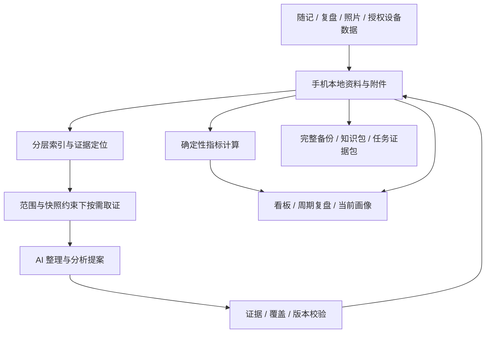

# Trace Life

面向个人的 Android AI 记录与知识管理应用。将日常随记、复盘、餐食照片和授权健康数据组织成可追溯、可分析、可迁移的个人知识库，帮助理解近期变化、长期模式和下一步行动。

**当前阶段：M3 DeepSeek 接入与自动分批整理后端。** 已有 M1 离线记录入口、M2 数据转移接口、受控取证，以及 DeepSeek 适配器和可恢复分批整理；新增接口尚未接入页面。用户已配置 KEY，一条合成记录的真实调用测试通过；语义核对、正式报告、看板、画像和华为接入仍待实现。本仓库管理项目设计和代码；个人生活记录存放在应用数据区。

## 当前可用功能

- 新建、编辑随记和复盘；记录日期、日期区间或未知时间，支持补记及多个主题。
- 按日期与主题分页查阅，查看修订历史、归档／恢复和永久删除。
- 使用内置每日、每周、事件模板；导入文本或 Markdown，预览后保存个人模板，并保留版本与旧复盘绑定。
- 将图片作为受管附件保存；当前阶段尚不识别食物或生成 AI 分析。
- 使用系统标准控件提供操作入口，暂不进行视觉设计。

新增后端能力：可移植口令加密备份、带预览与版本检查的恢复、分层 Markdown／JSONL 阅读包，以及指定问题／范围的证据包。用法、格式与限制见[数据转移接口](docs/DATA_TRANSFER.md)。完整备份保留修订、旧模板绑定、附件与删除记录；阅读包明确不用于恢复。

受控分析后端支持按范围分页定位、按字段分片取证、完整请求预算、每次调用的引用校验、失败恢复和幂等重试。结果保存为待核对提案，来源变化会阻止旧任务继续执行；任务与证据台账同时纳入加密备份。用法见[受控分析接口](docs/CONTROLLED_ANALYSIS.md)；DeepSeek 密钥配置、自动分批及显式真实测试见[接入说明](docs/DEEPSEEK.md)。

构建、安装及验证命令见[开发文档](docs/DEVELOPMENT.md)。当前仍用合成资料验证，文件选择和恢复确认等前端入口后续统一接入。

```bash
./gradlew testDebugUnitTest lintDebug assembleDebug
```

## 产品范围

- **低负担记录**：随手写、不完整记录、事后补记；可选有深度的日／周／事件复盘，支持导入个人模板。
- **AI 整理与分析**：提取观察、知识和有依据的洞察，形成行动并在后续复盘中回看。
- **关键趋势看板**：聚焦睡眠、运动、饮食、工作学习及行动的关键变化，数值可追溯，缺失资料明确显示。
- **长期个人画像**：区分自述、近期状态、情境模式与长期倾向，保留支持、反例和用户修正。
- **丰富输入**：餐食拍照分析；计划接入华为运动健康，资格、目标字段和真实设备授权仍需验证。
- **资料自主保存**：手机本地主存，支持完整恢复备份、分层知识包、指定范围证据包及指标／报告导出。

首版面向个人使用，不包括多用户服务、通用历史资料导入或多设备双向同步。个人模板导入和完整备份恢复属于首版范围。

## 核心架构

结构化资料与受管附件共同构成权威资料；Markdown、分层索引和看板是可重建视图，已经生成的 AI 分析保留内容、证据和版本。模型读取必须经过程序执行的范围、快照、索引路由与预算约束。



资料保存在本地；用户已选择 DeepSeek 云端模型，调用时会发送本次任务选中的片段。凭据独立加密保存，不进入备份或 APK；供应商资料处理依据与限制见[接入调研](docs/research/2026-10-17-deepseek-integration.md)。

## 文档入口

| 目的 | 入口 |
| --- | --- |
| 了解完整产品设计、存储导出及验收场景 | [主设计](docs/superpowers/specs/2026-10-16-personal-knowledge-and-reflection-design.md) |
| 查阅各主题设计和官方研究依据 | [文档导航](docs/README.md) |
| 理解统一术语 | [CONTEXT.md](CONTEXT.md) |
| 决定下一阶段做什么、如何验收 | [开发路线](docs/ROADMAP.md) |
| 构建 APK、运行测试和定位代码 | [开发与验证](docs/DEVELOPMENT.md) |
| 调用备份恢复、知识包与证据包接口 | [数据转移接口](docs/DATA_TRANSFER.md) |
| 调用受控检索、预算执行与分析任务接口 | [受控分析接口](docs/CONTROLLED_ANALYSIS.md) |
| 配置 DeepSeek、分批整理与测试真实调用 | [DeepSeek 接入](docs/DEEPSEEK.md) |
| 了解架构取舍 | [本地主存决策](docs/adr/0001-local-source-of-truth.md)、[受控取证决策](docs/adr/0002-controlled-evidence-retrieval.md) |
| 由 AI Agent 继续工作 | [AGENTS.md](AGENTS.md) |
| 提交问题、修改文档或代码 | [CONTRIBUTING.md](CONTRIBUTING.md) |

当前采用 Kotlin、Android 系统控件和 SQLiteOpenHelper，最低支持 Android 8.0（API 26），编译与目标 API 36。备份采用口令派生密钥与 AES-GCM；DeepSeek 开发机真实调用已通过单样本验证，分析质量与实体手机能力仍需分别验证。
